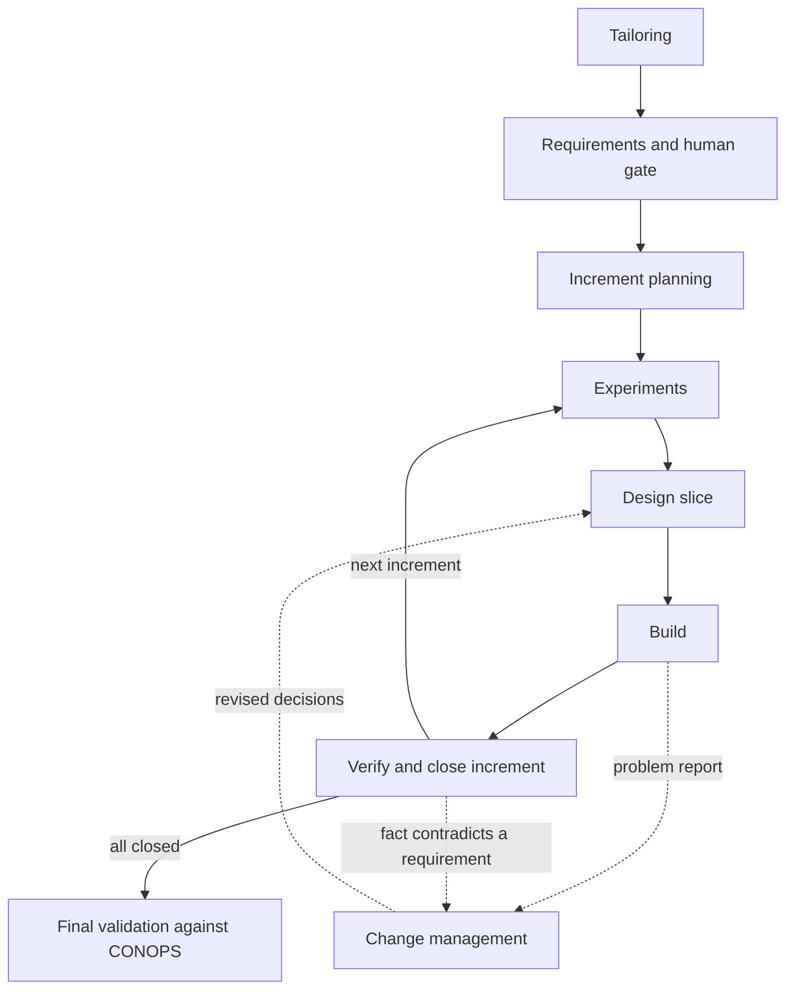
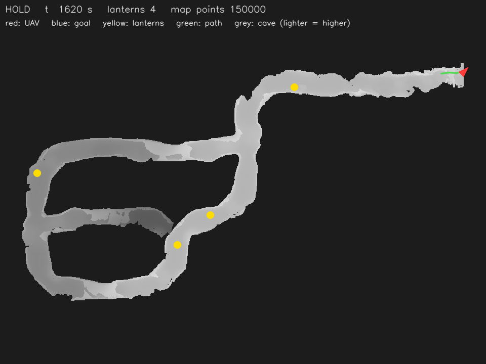

# se-skills

**A systems-engineering workflow for AI coding agents, tested on one autonomous-drone mission.**

> **Status:** experimental proof of concept, in active development, not a supported tool.

Designed by Alejandro Merino Arias; implemented with Claude Code under his direction.

## The problem

AI coding agents on long engineering projects tend either to specify everything on day one and
build on frozen assumptions, or to drift from task to task with no record of why. Systems
engineering exists to give such projects structure: requirements, verification, traceability and
controlled change. Applied naively, it stalls: the first version of this project (v1) produced
documents for
[23 rounds and never reached code](examples/uav-cave/results.md#v1-for-contrast).

More in [docs/motivation.md](docs/motivation.md) and [docs/v1-lesson.md](docs/v1-lesson.md).

## The idea

- **Small increments.** The system is built in increments, and each one is its own small V:
  requirements, design, build, verification.
- **Every unknown is sorted.** Each open point becomes a customer question, an experiment or a
  design decision, and it is tracked until closed.
- **Experiments first.** Anything the system or the simulator can answer is measured, not asked.
  The customer is asked only what only the customer can decide.
- **Scripts keep it honest.** [Eight Claude Code skills](plugin/skills/) guide the agent; Python scripts check the
  artifacts and compute where the project stands, so any session can resume from the files.

Details in [docs/how-it-works.md](docs/how-it-works.md).

## Case study at a glance

A simulated quadrotor must explore an unknown cave, find and report four lanterns, map the cave
and return to the entrance within 30 minutes, using only its own noisy sensing
([mission](examples/uav-cave/mission.md)). se-skills ran it from brief to final validation in one
session. All figures below come from [results.md](examples/uav-cave/results.md).

| | |
|---|---|
| Duration | 2026-09-28 to 2026-10-05, one session; [42.2 active hours](examples/uav-cave/results.md#cost) |
| Increments | [6, of which 5 verified; 1 failed and was re-planned into the next](examples/uav-cave/results.md#process) |
| Requirements | [105 (51 system level, 54 item level)](examples/uav-cave/results.md#process) |
| Open items | [93, all closed: 47 experiments, 45 customer questions, 1 design decision](examples/uav-cave/results.md#process) (51 further design decisions are recorded in [architecture.md](examples/uav-cave/se/architecture.md)) |
| Defects, by how found | [72 fix commits: 56 in simulation, 10 in review, 6 other](examples/uav-cave/results.md#defects) |
| Acceptance series | [2 of 3 runs met all five success criteria](examples/uav-cave/results.md#outcome--acceptance-series-3) (the customer's acceptance rule: 2 of 3) |
| Final validation | [nominal run back at the entrance at 1511 s with 92.9% map coverage; 353 test cases, 0 failures; 6 of 6 concept-of-operations (CONOPS) use cases](examples/uav-cave/results.md#outcome--final-validation) |

For contrast, v1 on the same mission ran
[23 rounds, asked 41 customer questions and wrote no code](examples/uav-cave/results.md#v1-for-contrast).
That failure is the lesson v2 is built on: questions an experiment can answer never go to the
customer, and nothing is specified far ahead of what is being built. v2 still asked 45 customer
questions, most of them approvals of criticality-A work, which is an open problem
([details](docs/v1-lesson.md#what-changed-in-practice)).

This is one case study with no baseline: there is no second run and no run without se-skills, so
none of these numbers is a comparison.

## What's in this repository

| Path | What it is |
|---|---|
| [docs/motivation.md](docs/motivation.md) | Why long engineering projects need more than a coding assistant |
| [docs/v1-lesson.md](docs/v1-lesson.md) | v1's design, why it stalled, and the v2 rule each failure produced |
| [docs/how-it-works.md](docs/how-it-works.md) | The method, illustrated with excerpts from the case study |
| [docs/testing-the-skills.md](docs/testing-the-skills.md) | How the skills were pressure-tested before use |
| [docs/how-this-was-built.md](docs/how-this-was-built.md) | Who did what: the author and the AI agent |
| [docs/limitations.md](docs/limitations.md) | What the evidence does and does not support |
| [plugin/](plugin/) | The eight skills and the Python scripts with their tests |
| [examples/uav-cave/](examples/uav-cave/) | The case study: requirements, open items, increments, evidence, results |

The mission code is not published; it is available on request.

## How it was built

The author designed the method and its rules, diagnosed v1, set v2's direction and made every
customer decision; Claude Code drafted the skills, the scripts and all the mission code under that
direction. Details in [docs/how-this-was-built.md](docs/how-this-was-built.md).

## Status and limitations

One case study, no baseline, and the author acted as the customer, so the results show that the
workflow can carry a mission to validation, not how it compares. Cost, operator workload and next
steps are in [docs/limitations.md](docs/limitations.md).

## Author

Alejandro Merino Arias — aerospace engineering student
