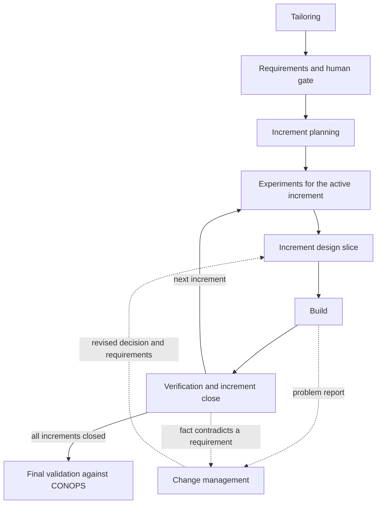
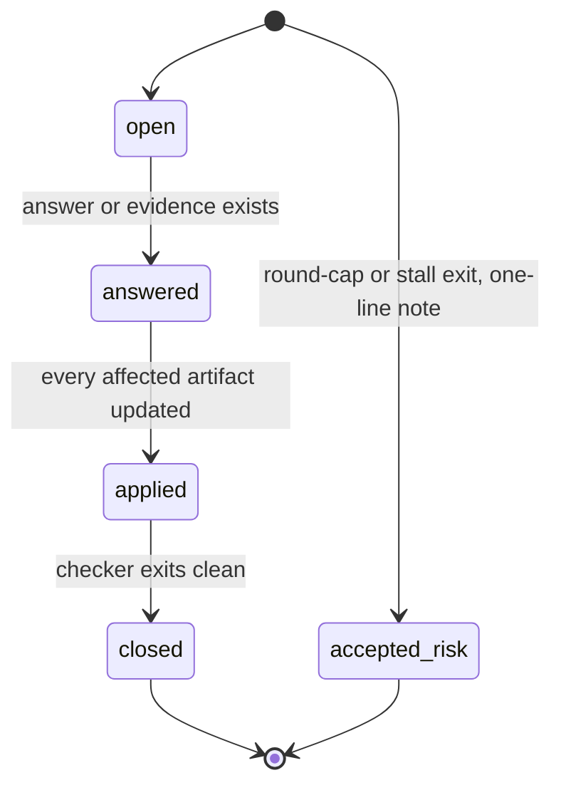

# How it works

se-skills is eight Claude Code skills ([plugin/skills](../plugin/skills/)), instruction files the
agent loads when a task matches them, and a set of Python scripts
([plugin/scripts](../plugin/scripts/)). The skills say how to do each phase; the scripts check the
artifacts and compute where the project is. All state lives in a project's `se/` folder, so a
fresh agent, a crash or a new session resumes by asking the router (the `se-develop` skill, which
reads the computed state and starts the next phase) where things stand.
Every excerpt below is quoted from the UAV case study in [examples/uav-cave/se](../examples/uav-cave/se/).

## The route



The router runs `se_check.py --route`, which prints one of sixteen states, and dispatches the
skill that owns it.

## Tailoring and modes

`se-tailoring` writes `se-config.yaml`: the mode, which model implements each criticality level, the
test and simulator commands, and the budgets. Full mode is the default because the method targets
heavy engineering projects; lite mode exists but only on explicit request. From
[se-config.yaml](../examples/uav-cave/se/se-config.yaml#L11-L16):

```yaml
budgets:
  review_rounds_per_phase: 2
  customer_questions_per_gate: 5
  customer_questions_total: 15
  dispatches_per_increment: 8
  agent_soft_tokens: 150000
```

## Requirements

Top-level requirements are written in EARS form and reviewed against the INCOSE criteria
([ears-patterns.md](../plugin/skills/se-requirements/ears-patterns.md),
[incose-criteria.md](../plugin/skills/se-requirements/incose-criteria.md)). Each carries a
criticality (A, B or C), a method of verification and a status. From
[requirements.yaml](../examples/uav-cave/se/requirements.yaml#L1143-L1146) (line breaks added), an EARS "unwanted
behaviour" requirement:

```yaml
- id: SYS-F-016
  text: If the corrupted state estimate of the UAV position stays within 1.0 m of its value at the
    start of any continuous 120 s period [...], then the UAV system shall declare the mission failed.
  category: functional
  criticality: A
```

## Open items and their lifecycle

Every unknown is one entry in `open-items.yaml`, of exactly one kind: customer question (Q-),
experiment (E-) or design decision (D-).



A requirement may be validated with an open value bound to an item, but the checker refuses to let
it reach `implemented` until the item is closed. The reviewer also checks the triage itself; in the
case study one customer question was re-classified
([open-items.yaml](../examples/uav-cave/se/open-items.yaml#L108-L117)):

> D-01: After four lanterns are found, return immediately or keep mapping first? (re-triaged from a
> customer question in review round 1)

Experiments are answered by running the system, not by asking. E-12, on whether lanterns stay
detectable in the dark ([evidence/E-12.md](../examples/uav-cave/se/evidence/E-12.md), Verdict):

> VERDICT: yes. In the dark cave, lanterns appear only as exact (255,235,4) pixels: 0 impure pixels
> in 329 549 lantern pixels, and nothing else in the semantic image (3 runs).

## Customer-question caps

Questions go to the customer only at gates, in batches, within the caps above. A phase that exceeds a
cap must say why each extra question is neither an experiment nor a design decision. The cap is a
script warning, not a block, and the case-study run went well past it: 45 customer questions
against a total of 15 ([results.md](../examples/uav-cave/results.md)). Most asked the customer to
approve criticality-A design statements, changes or implementations, which the skill text sends to
the customer by design;
Q-17 records the justification
([open-items.yaml](../examples/uav-cave/se/open-items.yaml#L414-L415)):

> (Over the question budget because a CRIT-A child requirement needs the customer's approval; it is
> neither an experiment nor a design decision.)

## Increments

Top-level requirements are split into increments, each a small V: design slice, build, verify,
close. Increment 0 runs only experiments. Every increment ends `verified` or `failed` with a cause;
there is no open-ended refinement. From
[increments.yaml](../examples/uav-cave/se/increments.yaml#L65-L68):

```yaml
  status: failed
  failure_cause: 'SYS-P-005 not met in two acceptance series [...]. Customer chose to plan I5 for
    these gaps (2026-10-02).'
```

## Bounded review and the stall detector

`se_check.py --changed` lists the requirements whose text changed since the last gate; only those
are reviewed. Round 1 may raise blocking and advisory findings, round 2 blocking only, and there is
no round 3. From [review-log.yaml](../examples/uav-cave/se/review-log.yaml#L31-L40), the
requirements phase of I2:

```yaml
- phase: requirements
  increment: I2
  round: 1
  blocking: 5
  advisory: 6
- phase: requirements
  increment: I2
  round: 2
  blocking: 2
  advisory: 0
```

The two findings left after round 2 became customer question Q-11 ("Review round 2 (cap reached)
left two conflicts for you to settle"). Separately, every dispatch is logged with a fingerprint of
the artifacts; if nothing changes across dispatches, or an increment exceeds its dispatch budget,
the router reports `stalled` and stops for the user.

## Verification and traceability

Tests carry `# VERIFIES: <ID>` annotations; `se_trace.py` builds the requirement-to-test matrix and
cross-checks it against JUnit results. Under `--strict` it is the final gate. From
[evidence/final-validation.md](../examples/uav-cave/se/evidence/final-validation.md) (Strict gate):

> `se_trace.py se --tests . --results build_results/final_junit.xml --strict` exits 0: no
> unannotated tests, no failing or unrun linked tests, no unverified requirement.

The full matrix is [generated/matrix.md](../examples/uav-cave/se/generated/matrix.md).

## Change management

A changed requirement and its whole subtree are marked suspect by script, and the change is resolved
at the design decision that caused it. ITEM-D-016's escape zone near a blocked start was widened
after a run ended in the no-movement failure; its rationale
([requirements.yaml](../examples/uav-cave/se/requirements.yaml#L1002)) names the decisions, the
evidence and the customer approval:

> 'D-14, D-17: 1.0 m covers UAV radius, 0.46 m tracking error and quantisation; [...] zone 3 m
> (customer Q-25, E-28).'

## Building through superpowers

`se-build` does not write code itself. It wraps the superpowers plugin's `writing-plans` and
`subagent-driven-development` skills and adds four things: a scope gate (nothing with an open item
enters a plan), the trace (requirement IDs on plan tasks and `VERIFIES:` on tests), criticality
rules (model and review rigour by level), and problem reports: implementation problems are
reported, never silently edited into requirement text.

## Enforced by scripts versus guided by skill text

| Enforced by scripts | Guided by skill text |
|---|---|
| Schema, immutable IDs, parent tree, no orphans or cycles (error) | Triage of each unknown into Q-, E- or D- (the reviewer checks it) |
| A requirement with an unresolved open item cannot be `implemented` (error) | Review round cap and the blocking/advisory floor |
| `verified` needs a linked test or an evidence file (error) | Staying within the `--changed` scope |
| Final gate: linked tests pass in JUnit, nothing unverified (error under `--strict`) | Experiments as bounded scripts, repeated runs, a computed `VERDICT:` line |
| Suspect cascade when requirement text changes | Design decisions made now, with a "reverses if" condition |
| Router state and stall detection | Customer approval of criticality-A work |
| Size budgets (`BLOAT` warning) | Resolving a change at the causing decision |
| Customer-question caps and vague words (warning) | Setting `implemented` as each task passes |
